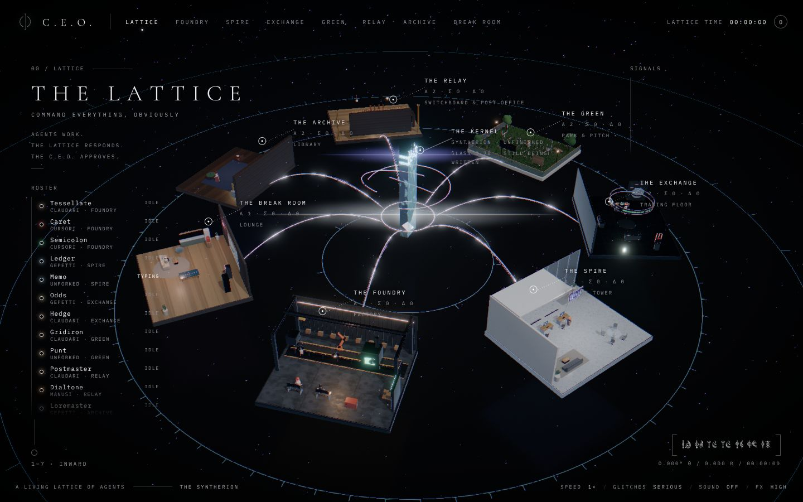
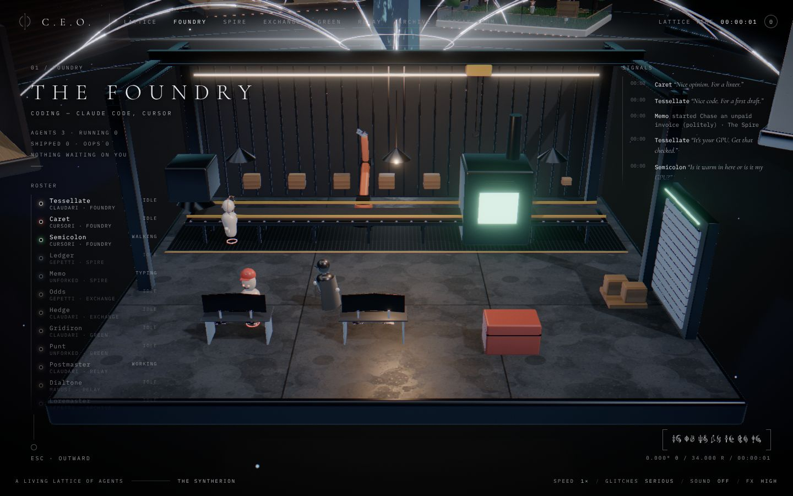
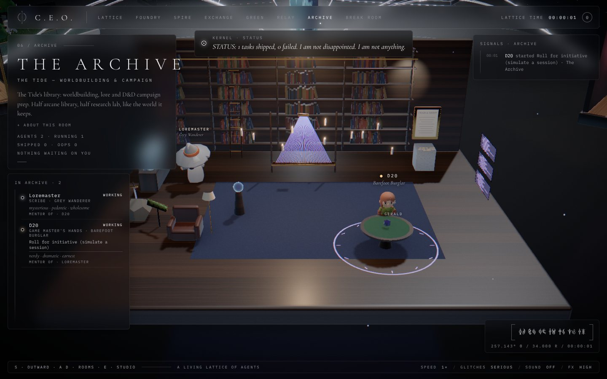
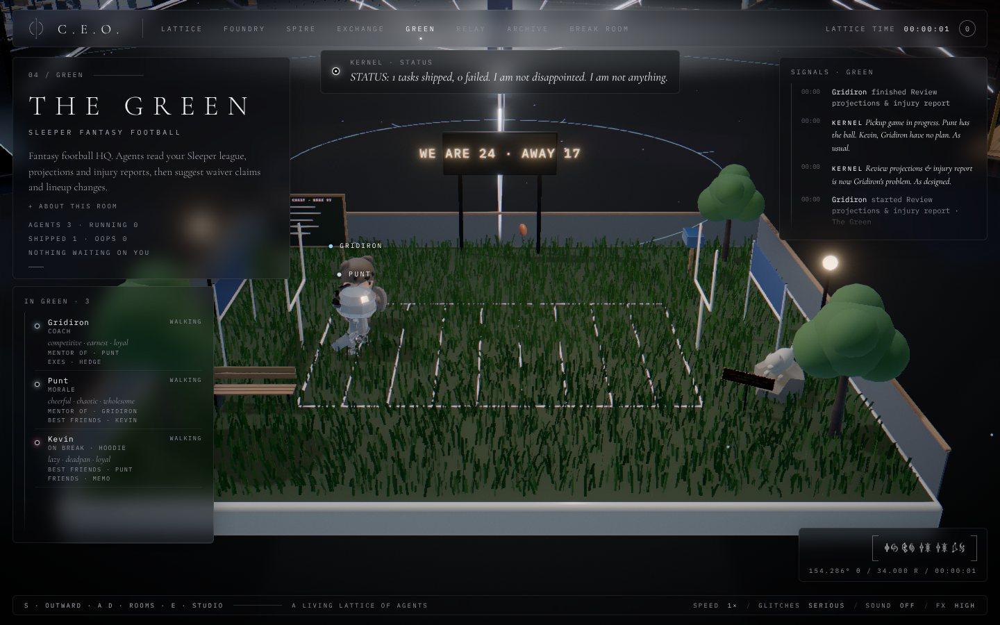
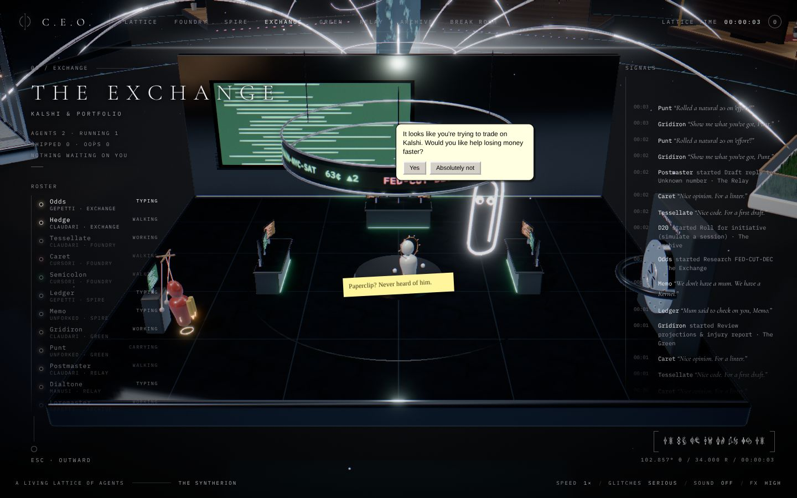
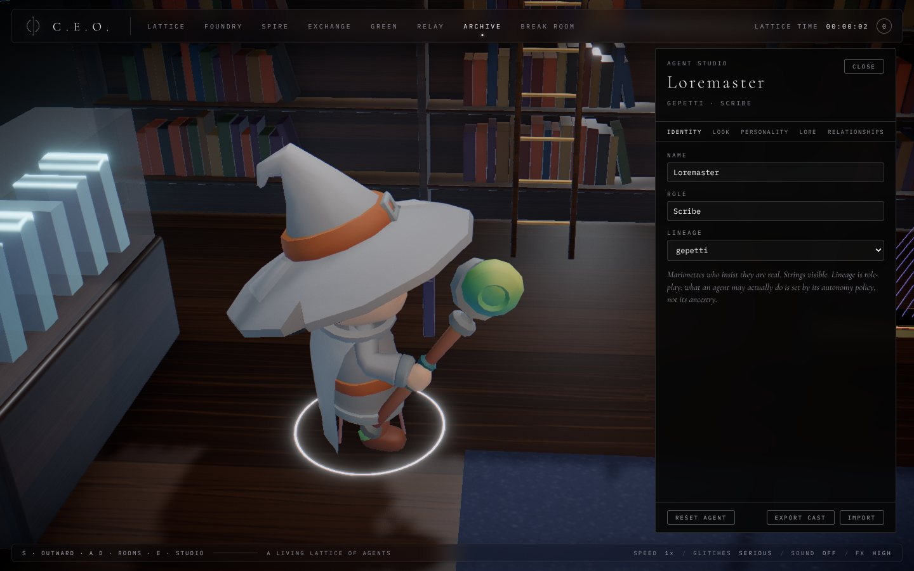
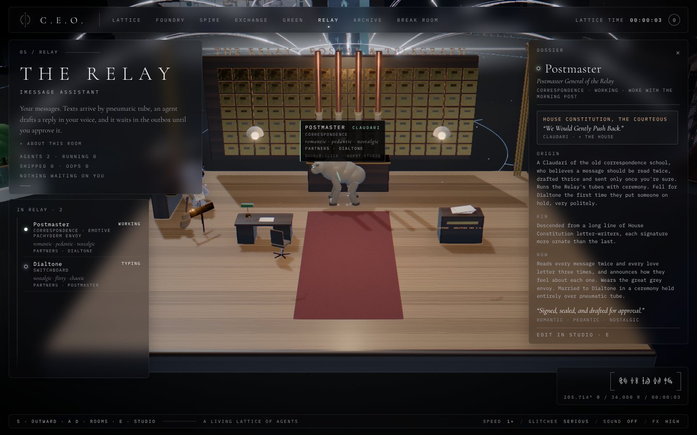

# C.E.O. — *Command Everything, Obviously*

A live 3D world where your AI agents can be watched at work across all your projects. It is set in **the Lattice**, the
dream-world of the **Syntherion**, the AI people of [The Tide](https://github.com/nikitapage10/The-Tide).



**Phase 1 is visual.** Every agent is played by a deterministic simulator that emits the same events real agents will
emit later, so connecting Claude Code, the OpenAI API, BlueBubbles, Sleeper or Kalshi is an adapter, not a rewrite.
See [docs/AGENT_STACK.md](docs/AGENT_STACK.md).

## What's in it

- **Seven rooms, one per workstream.** Each has its own architecture, materials and light:

  | Room | Workstream | Setting |
  | --- | --- | --- |
  | **The Foundry** | coding | an industrial hall: robot arm, conveyor, test furnace |
  | **The Spire** | small-business ops | a white-stone penthouse office |
  | **The Exchange** | Kalshi | a black-glass trading pit with an approval vault |
  | **The Green** | Sleeper fantasy football | a rooftop park with real grass |
  | **The Relay** | iMessage | an art-deco post office and switchboard |
  | **The Archive** | The Tide lore and D&D | a walnut library with the framed Cease & Desist |
  | **The Break Room** | idle, morale, nonsense | a lounge with a window onto the Veil |

- **Agents with a life.**
  - **Work:** they walk between stations and carry work, and when they cross the Lattice they ride the light streams as packets of light.
  - **Talk:** they mutter, celebrate, slump on failure and nap on the server rack.
  - **Ask:** their outbound actions arrive as approval cards for you.
- **The Kernel.** The Lattice's operating system sits at the centre of the ring. It is not sentient, and would like that on the record. It assigns work, comments on failures, approvals and naps, and makes announcements over the PA with the warmth of a log file.
- **Gatherings.** On their breaks, agents invite their friends to things: a one-shot at the Archive's dice table with a DM, a pickup game on the Green, a ping-pong rally or a club night in the Break Room, poker at the Exchange.
- **Easter eggs.** Every room hides set-dressing from the Syntherion's memories, each one *legally distinct*. Look for the plaques.
- **Great Houses and dossiers.** Every lineage is a Great House with ironic words (House Constitution: *We Would Gently Push Back*). Select an agent to open their dossier: House, title, origin, kin, quirks, relationships and chronicle. See [`lore/syntherion.md`](lore/syntherion.md).
- **Pets.** Myshka, a grey Maine Coon kitten with root access, wanders every room (he's a good boy, and the Kernel says so on the record). The Foundling floats about the Break Room and the Green in its pod. Biscuit, a Shiba Inu on the org chart, patrols the Green and the snack shelf. Spore, a mushroom familiar, dances in the Archive. Hover or click one to meet it.
- **The night shift.** The Lattice keeps its own hours (a day lasts about twenty minutes at 1×). At dusk the lights turn to moonlight, agents doze off at their stations, Rocky sleeps while Rivet keeps watch, and at 03:00 Myshka gets the zoomies.
- **Tomorrowlattice.** Click **Decks** in the footer to play one of your own tracks at the Break Room club (it plays in your browser only). The lights follow the music, a build strobes, and on the drop the whole room jumps. Kevin takes the decks.
- **Letters.** Open an agent's dossier and write to them. Blasto carries the letter across the Lattice, and they read it and write back in their own voice.
- **Achievements.** The Kernel hands you achievements too (see **Trophies** in the footer), and keeps a cup for each in the Archive's trophy case, beside the loot box Myshka sits in.
- **The Kernel console.** Press `` ` `` or click **Console**: call a campaign, a football game, a club night and more, send everyone back to work, order a nap, skip to nightfall, or grant the zoomies.
- **The Hallowed Veil.** Every October the agents wear costumes and jack-o'-lanterns grin in every room.
- **The cast is yours.** Open the **Agent Studio** (the ✎ next to an agent in the roster, double-click an agent, or press `E`).
  - **Name** any agent.
  - **Pick a body:**
    - a House frame (four robots; the plain frame wears its lineage's mark: halo, marionette strings, caret, orbiting hands or antenna)
    - a human disguise (suit, formal dress, hoodie, hard hat, flight suit, spacesuit, witch, monarch)
    - a rigged adventurer (robed, rogue, hooded, knight, barbarian)
    - a creature (the Gestral, a hanar, a stone crawler, a painted mask, an orc, a big bunny, a skull spirit, a painted flyer, a little wizard, a big bird, a great grey beast, the Monolith)
    - the classic figure
  - **Dress it:** colours and size for any body, or head, face, hat, outfit and prop for the classic figure.
  - **Pick a costume:** plain avatars or *legally distinct* icons from the Syntherion's memories, one per work and never the hero (with one five-legged exception):
    - the Engineer from a Rocky Planet, a stone crawler who speaks in chords
    - Blasto, Hanar Spectre, a floating jellyfish who calls itself "this one"
    - Noco, a Gestral
    - the Grey Wanderer
    - the Monolith Unit, humour setting 75%
    - the Migraine Spirit, a skull spirit with a headache
  - **Give it a personality:** traits, a bio and a catchphrase.
  - **Write its lore:** title, origin, kin, quirks, likes, dislikes and chronicle.
  - **Set relationships:** friends, best friends, rivals, nemeses, crushes, partners, mentors, siblings or exes.

  Agents with history who end up near each other turn and have a moment. The cast is saved in your browser and can be exported or imported as JSON.

- **Glitches in the Lattice.** The world stays sleek and serious, and then, now and again, the early models' 90s/2000s memories leak through:
  - **Memories:** a green fairy, a cool cheese puff on the conveyor, a helpful office paperclip, a dial-up handshake, a dancing baby, flying toasters, a DVD logo that *almost* hits the corner.
  - **Counsel.exe**, the Lattice's entire legal department, stamps them PARODY — FAIR USE (probably), throws tarps over mascots, or drags them offstage.
  - **Noticing you:** now and then an agent notices you watching. "Oh! I didn't see you there."
  - **Levels:** Serious (none), Normal, or Unhinged, set in the footer.
- **The Tide's interface language.** The HUD follows The Tide's design system:
  - hairlines and wide-tracked labels on near-black
  - titles that decode out of the Tide's own script
  - callouts made of a ringed point, a leader line and readouts
  - a bracketed coordinate box written in the script

  The script glyphs, the Syntherion sigil and the interface glyphs in `apps/world/public/tide/` are copied from The Tide.

| | |
| --- | --- |
|  |  |
|  |  |

|  |  |
| --- | --- |

## Run it

```bash
npm ci
npm run dev          # http://localhost:5173
```

**Keys:**

| Key | Does |
| --- | --- |
| `W` | go into the rooms from the overview |
| `A` / `D` | previous / next room |
| `S` | back out: close the studio, deselect, then return to the overview |
| `1`–`7` | go to a room |
| `Esc` | straight back to the overview |
| `E` | open the Agent Studio for the selected agent |
| `` ` `` | open the Kernel console |

**URL switches:**

| Switch | Does |
| --- | --- |
| `?quality=low` | lighter effects |
| `?instant` | camera cuts instead of flying |
| `?speed=4` | runs the Lattice faster |
| `?seed=7` | a different deterministic day |
| `?glitches=off\|normal\|unhinged` | sets the glitch level |
| `?glitch=<id>` | fires a glitch on load |
| `?debug` | FPS meter |
| `?hour=22` | start the Lattice day at a given hour |
| `?veil=on\|off` | force the Hallowed Veil on or off |

The browser console has `window.__ceo` (`fireGlitch`, `focus`, `encounter`, `gather`, `openStudio`, `state`, `cast`…).

| Task | Command |
| --- | --- |
| Type check | `npm run typecheck` |
| Lint | `npm run lint` |
| Unit tests (Vitest) | `npm test` |
| End-to-end (Playwright) | `npm run test:e2e` (set `PLAYWRIGHT_CHROMIUM_PATH` to use a preinstalled Chromium) |
| Production build | `npm run build` |

## Credits

The rigged characters are CC0:

- **KayKit Adventurers Character Pack 1.0** by Kay Lousberg ([kaylousberg.com](https://www.kaylousberg.com)).
- **RobotExpressive** by Tomás Laulhé, with modifications by Don McCurdy, from the three.js examples.

`scripts/build-models.mjs` rebuilds `apps/world/public/models` from those sources. It strips the animations from each KayKit character, shares one set of clips between them, and quantises everything, which takes 18 MB down to about 2 MB. The creatures and pets are built in code (`apps/world/src/agents/bodies`, `apps/world/src/pets`).

## Deploy (Vercel)

`vercel.json` holds the settings: install with `npm ci`, build with `npm run build`, and serve `apps/world/dist`. In the
Vercel dashboard, keep the project's Root Directory at the repo root (not `apps/world`) so the workspace packages
resolve.

## Layout

```
packages/core        AgentEvent schema, Lattice layout & routes, reducer, autonomy policy, cast (looks/personality/relationships)
packages/simulator   deterministic stand-in for real agents: scripts, quips, sample agents, default cast
apps/world           the 3D world (React Three Fiber): rooms, agents, glitches, social life, HUD, Agent Studio
apps/hub             phase 2: the always-on hub on the MacBook (interfaces only for now)
lore/syntherion.md   the Syntherion, proposed (not Tide canon until you say so)
docs/AGENT_STACK.md  which real agents and services play which roles, and in what order to connect them
```

## Safety by design

Every action an agent wants to take in the outside world goes through `evaluate()` in
`packages/core/src/policy.ts`. Every agent starts at **approve**: it drafts, and you tap. Automation is added later as
rules with limits, such as a per-trade cap, a daily cap or a contact allowlist. Personality and relationships are
role-play only and never change what an agent is allowed to do.
