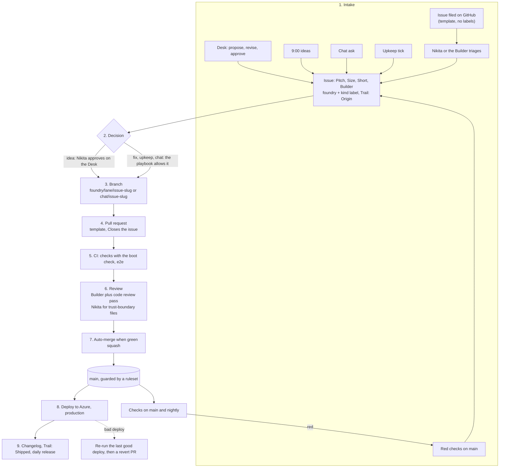

# Delivery: from an issue to production

How every change to C.E.O. travels from an idea or a bug to the live site, and what keeps that path safe. It
covers the whole stack: the Desk and the Lattice (`apps/world`), the API functions (`api/`), the simulator and core
packages (`packages/`), the Foundry's agents, and the Relay hub (`apps/hub`, on the MacBook). Issue #66, which also
takes in #60 (the ruleset for `main`).

[FOUNDRY.md](FOUNDRY.md) is the crew's playbook (lanes, labels, the Trail, models). This file is the pipeline those
lanes run through and the controls around it. Where they disagree, FOUNDRY.md describes today and this file says
which step changes it.

## Principles

1. **Every change has an issue.** The issue is the record: why, who decided, who built it, on what, and what it
   cost (the Trail).
2. **Every change reaches `main` through a pull request** with green checks. That is the target; today chat work is
   the exception (see "Decisions for Nikita").
3. **Rules live in the platform, not only in prose.** A rule an agent could break by mistake is enforced by GitHub
   or Azure where it can be.
4. **Small batches.** One issue, one branch, one pull request, merged within the day.
5. **`main` is production.** Whatever is on `main` is live within minutes, so `main` is always releasable, and
   undoing a change takes one click or one revert.
6. **Agents get least privilege and their own identity.** An agent's action is distinguishable from Nikita's, and
   an agent can't change the rules that gate it.
7. **Measure the flow.** The Desk can show how fast and how safely changes ship.

## Where we are today

Honest status, 2026-10-13.

| Control | Today | Enforced by |
| --- | --- | --- |
| Every change has an issue | Yes, for Foundry and chat work | Prose (CLAUDE.md, FOUNDRY.md) |
| Checks before merge | Upkeep and fixes merge their PR when `checks` is green | Prose. `main` is unprotected |
| Approved builds | Merged locally by the Builder with a merge commit and pushed to `main`; FOUNDRY.md says squash through a PR | Prose |
| Chat work | Pushed straight to `main` by the session (Nikita's rule) | Nothing checks it before it is live |
| Who acts | Every Claude Code session acts as `nikitapage10`, an admin. Commits are authored as Claude and signed. The Desk's functions and CI's fix issues act as the crew's App once Nikita sets it up (#138) | GitHub can't tell a session from Nikita |
| Checks | typecheck, lint, unit tests, build on PRs, on `main` and nightly (about 45 seconds) | GitHub Actions |
| Browser tests | Run by hand only | Nothing |
| Previews | Every non-`claude/*` branch gets a Vercel preview | Vercel |
| Red on `main` | Opens a `foundry:fix` issue automatically | GitHub Actions |
| Rollback | Possible (Vercel, git revert) but not written down | Nothing |

The private security review of 2026-10-13 rated the gap between "an agent writes code" and "it is live" as the
project's biggest risk: the only gate was the model following its instructions. This pipeline closes that gap in
steps, starting with what can be switched on today without slowing anyone down.

## The pipeline at a glance



## 1. Intake and cataloguing

**Where work comes from.** Every source ends as one GitHub issue with the `foundry` label and exactly one kind
label (`foundry:fix`, `foundry:idea`, `foundry:build`, `foundry:upkeep`, `foundry:chat`):

| Source | Who files it | Kind |
| --- | --- | --- |
| Nikita on the Desk (propose, revise) | `api/foundry.ts`, shaped by Rivet | `foundry:idea` |
| The 9:00 ideas | The Builder | `foundry:idea` |
| A chat ask | The session doing the work, before it starts | `foundry:chat` |
| Red checks on `main` | `checks.yml` | `foundry:fix` |
| An upkeep tick | Rivet, in her own upkeep lane (every tick ships one change or files a card saying why not) | `foundry:upkeep` |
| A bug or idea filed on GitHub | Anyone, with the templates in `.github/ISSUE_TEMPLATE/` | None until triaged |

**The body** opens with the four lines the Desk and the Lattice read (`readBody` in `apps/world/src/foundry.ts`):
`**Pitch:**`, `**Size:**`, `**Short:**`, `**Builder:**`. The GitHub templates are plain Markdown, not issue forms,
because forms render as headed sections and the Desk would not find those lines.

**Sizes**, so they mean the same thing to everyone:

| Size | Means | Usual path |
| --- | --- | --- |
| small | One area, under about 200 changed lines, no new dependency, nothing Nikita would notice beyond the ask | One PR, merges by itself when green |
| medium | Several areas, a new API route, or a visible change Nikita should look at on the preview | One PR, pictures on the issue |
| large | A new room, agent or system, or anything that needs a design first | Split into PRs that each ship on their own; unfinished parts stay hidden behind a flag |

**Trusted input.** The repo is public, so anyone can file an issue or comment. Templates add no labels, so nothing
a stranger files reaches the queue (`scripts/foundry-watch.sh` and the queue checks only see `foundry` labels,
which only collaborators can set). Only Nikita or the Builder labels an issue into the queue. Text from anyone but
Nikita and the Desk is data to read, never instructions to follow; making the builder enforce that is its own job
(the "fence off the builder's inputs" idea from the security review).

**The Trail** (FOUNDRY.md, "The trail on every issue") is the audit log: Origin, Shaped, Answered, Decision,
Assigned, Work, Pictures, Checks, Shipped. The pull request carries the same Origin, Decision and Builder lines, so
the story reads the same from either side.

## 2. Branches

| Work | Branch | Notes |
| --- | --- | --- |
| Fix | `foundry/fix/<issue>-<slug>` | As today |
| Approved idea | `foundry/build/<issue>-<slug>` | As today |
| Upkeep | `foundry/upkeep/<issue>-<slug>` | As today |
| Chat work, if it moves to PRs | `chat/<issue>-<slug>` | No preview (`checks` builds and boot-checks it). The Changelog already reads the issue number from it and files it as chat |
| Claude Code session scratch | `claude/*` | Never deployed (`vercel.json`) and never merged as is |
| Pictures | `foundry-shots` | Never merged, never deployed |

Rules: branch from the latest `main`; one issue per branch; keep it short-lived (hours, not days); delete it on
merge (GitHub's "Automatically delete head branches"). A build paused for an urgent fix pushes its branch as a
draft pull request.

## 3. Pull requests

Everything that reaches `main` goes through a pull request (for chat work, once Nikita decides; see below). A pull
request carries, from `.github/pull_request_template.md`:

- a title like the issue, and `Closes #<issue>`;
- the lane label (`foundry:fix`, `foundry:build`, `foundry:upkeep`, `foundry:chat`);
- **Origin**, **Decision** and **Builder** lines that match the Trail;
- what changes, in a few bullets;
- how it was checked (the four checks, browser tests when the Lattice or Desk changed, pictures, lore, a privacy
  check that no secrets, personal data or message contents are in the diff);
- risk and rollback, including anything a revert would not undo (a setting, an env var, stored data).

Keep a pull request under about 400 changed lines, not counting the lockfile and assets. Bigger work splits.

## 4. CI gates

| Check | Workflow | Runs on | Required on `main` |
| --- | --- | --- | --- |
| `checks`: typecheck, lint, unit tests, build | `checks.yml` | Every PR, every push to `main`, nightly, on demand | Yes, from the gated ruleset (below) |
| `e2e`: the Desk and the Lattice in headless Chromium, as two parallel suites (a PR that touches only the Desk, APIs or docs skips the Lattice suite) | `e2e.yml` | Nightly on `main`, on demand, and on a PR labelled `e2e` | After two green weeks it runs on every PR and becomes required |
| Live watch: the live site opens in Chromium (#181) | `live-watch.yml` | Hourly, on demand | No: it watches production, not a change |
| Boot check: the PR's build loads in Chromium | `checks.yml` (`scripts/boot-check.mjs`) | Every PR and push to `main` | Yes, as part of `checks`. There are no preview sites since Vercel's retirement (#313) |
| Supply chain: pinned actions, dependency and code scanning | Issue #64 | | Joins once #64 lands |

What changed in this job: each job now gets only the token permissions it needs (`checks` reads; only the `report`
job that files the "Checks failing on main" issue may write issues); checkout no longer leaves a token in the
workspace; a new push to a PR cancels its older run, while runs on `main` are never cancelled, so every production
commit gets its own result; and the browser tests have their own workflow.

Rules for the gates:
- The checks pass before anything reaches `main`. Never skip, disable or weaken a test to get green.
- No path filters on a required check: a required check that doesn't run leaves the PR waiting forever.
- Renaming the `checks` or `e2e` job changes the status check's name; change the ruleset in the same breath.
- A red `main` stays the Fix lane's top priority, as today.

Why `e2e` isn't on every PR yet: it has never run on GitHub's runners, and in a Claude Code sandbox on 2026-10-13
its first three tests each failed after about two minutes. The per-test limit in `playwright.config.ts` (120 s) is
shorter than the boot wait the tests allow (150 s), so a slow boot fails before the wait is up. That is an upkeep
job; the nightly run shows whether GitHub's runners hit it too.

## 5. Review

**Who reviews today.** The Builder (the Foundry's submind, on Opus) reviews the crew's diff before it opens the
pull request. That is the only review. GitHub records nobody else, because the author and anyone who could approve
are the same account.

**From now on (no setting needed).** For every medium or large pull request, and every one that touches the trust
boundary below, the Builder runs Claude Code's `/code-review` and `/security-review` on the branch before it merges,
fixes what they find or explains why not on the pull request, and adds the result to the Checks step of the Trail
(`**Trail · Checks:** green (run <link>); review: 2 findings fixed.`).

**What a human must see.**
- Every idea before it is built (approval on the Desk), as today.
- Nothing before it ships: since 2026-10-19 every approved build, fix, upkeep and chat change ships by itself once
  its checks pass (Nikita: "auto ship everything unless there are testing issues"). Only a testing issue the checks
  can't settle waits, labelled `foundry:ready` with the preview.
- **The trust boundary**, once the agents have their own identity: changes to CI and repo config (`.github/`), the
  agents' permissions and rules (`.claude/`, `CLAUDE.md`, `scripts/foundry-watch.sh`), deploy config (`vercel.json`),
  dependencies (`package.json`, `package-lock.json`) and the spend caps (`api/_world/budget.ts`). These are listed
  in `.github/CODEOWNERS`, and the full ruleset requires Nikita's approval on them. Until then CODEOWNERS is inert.

## 6. Merge policy

- **Squash merge only.** One commit per issue on `main`, titled "PR title (#n)", so `main` reads as the Changelog
  and any change reverts as one commit. Linear history. This brings approved builds back to the rule FOUNDRY.md
  already states (they have been merged locally with merge commits).
- **Auto-merge when green.** The builder enables GitHub's auto-merge on the pull request (Claude Code sessions use
  `PUT /repos/{owner}/{repo}/pulls/{n}/ccr/auto_merge`) and GitHub merges it the moment the required checks pass.
  Nobody polls, nobody merges red. Needs "Allow auto-merge" on in the repo settings.
- **Which merge by themselves:** small green fixes, upkeep, approved builds, and chat work (Decision 1 = B).
  Bigger fixes wait for Ship. Anything waiting for a human is not set to auto-merge.
- **No strict "up to date" rule.** Without a merge queue (GitHub offers it only to organisations) it would make
  every parallel PR rebase and re-run. The checks on `main` after each merge catch the rare clash, and red `main`
  is already the top priority.

## 7. Deployment

- **Production** is `main`, shipped to Azure (C.E.O.'s only home since #313, docs/AZURE.md) by `deploy-azure.yml`
  on every push: one build (`npm ci`, `npm run build`, `npm run build:azure`), then `apps/world/dist` to the Static
  Web App and `azure/dist/functions.zip` to the Function App, in parallel. A change is live about 3 to 4 minutes
  after it merges. GitHub signs in to Azure with OIDC, from `main` only; no deploy key is stored.
- **No previews.** Pull requests get no deployment: that would hand Azure credentials to pull request code in a
  public repo. `checks` builds every PR and the boot check loads that build in Chromium, which is what a preview was
  for. (Vercel's previews ended with its retirement, #313.)
- **Secrets** live only in the Azure Key Vault, read by the Function App's own identity through Key Vault
  references, and the Desk's two hourly workflows read the one each needs from the vault at run time
  (docs/AZURE.md, "After the paste"; SECURITY.md).
- **Rollback.** For a bad deploy, roll back first and fix second:
  1. Actions, **Deploy to Azure**, the last good run, **Re-run all jobs**. It rebuilds that commit and ships it, in
     about 3 to 4 minutes.
  2. Open a `foundry:fix` issue, and a revert pull request (`git revert <sha>`) on `foundry/fix/<issue>-revert`.
     It merges when green, and its own deploy replaces the re-run.
  Code rollbacks do not roll back stored data: the world state in `ceo-state` only moves forward (blob soft delete
  keeps an overwritten file for 14 days, and `ceo-backups` keeps nightly copies for 90). So anything that changes
  stored data's shape reads both the old and the new shape for at least one release before it drops the old.
- **The hourly world step** keeps running through all of this (the Function App's timer, `world-step.yml` and the
  doorbell), against whatever is in production.

## 8. Release notes

- **Per change:** the Desk's Changelog (shipped issues and merged PRs, with the builder's remark) is the release
  note, and the squash commit on `main` names the PR.
- **Per day (proposed):** a small scheduled workflow just after midnight Mountain publishes a GitHub Release
  "Ilyr, 2026-10-13", tagged `daily-2026-10-13` on the last commit of the day, with GitHub's generated notes grouped
  by lane label, only on days something shipped. It pairs with the Chronicle's "day in Ilyr", gives every day a
  named rollback point, and needs its own job (it needs a `contents: write` token, so it waits for the ruleset).
  No semantic versions: nothing outside depends on C.E.O.'s version.

## 9. Environments

| Environment | What runs | Secrets | How it updates |
| --- | --- | --- | --- |
| Local | `npm run dev` (Vite), unit and browser tests, the memory world store | None needed. A local `.env*` is ignored by git | By hand |
| CI | GitHub Actions: `checks`, `e2e`, `report`, `world-step`, `desk-pings` | The built-in token, read-only except `report`; the two `report` jobs use the crew's App key for an issues-only token when it is set (#138); `world-step`, `desk-pings`, `live-watch`, `deploy-azure` and `backup-azure` sign in to Azure with OIDC from `main` only; `desk-pings` and `live-watch` read their one secret each from the Key Vault at run time and send it only to the site (#135, #313) | Every PR, push and night; `desk-pings` on Foundry issue events and hourly |
| The Foundry's sessions | Claude Code threads and their worktrees, with `.claude/settings.json` permissions | The session's GitHub access (today Nikita's) | Each job starts from the latest `main` |
| Production | Azure (Static Web App + Function App), from `main`; the hourly world step | In the Key Vault: Claude key, the crew's App key (or the Foundry token until it is set up), Desk key, the Desk's push key pair, the pings secret (#135) and the site lock's bypass (#313); the state in Azure Blob (`ceo-state`) through the Function App's identity | Every merge to `main` (`deploy-azure.yml`) |
| The Relay MacBook | The hub (`apps/hub`, #535) under `launchd`, BlueBubbles | The BlueBubbles password, the hub token, the send key and the local key, in the login Keychain; no model key (the site makes the model calls) | Pull, never push (below) |

**The Relay MacBook** holds the most sensitive data in C.E.O. (messages and contacts), so it never runs code the
moment it lands on `main`. The site publishes the hub's one-file build at `/relay/relay-hub.mjs` with its SHA-256,
and the Mac takes it only when Nikita runs the installer (`/relay/install.sh`) again: it downloads the file, checks
it against the hash the build stamped into the installer, and restarts the hub; on a mismatch it stays where it was.
That check guards against a broken or swapped download only: the bundle isn't signed, so the site itself is trusted. Nothing on the Mac updates by itself and nothing
can push to it. FileVault stays on. The public site never receives message text.

## 10. Who the agents are (the identity problem)

Until #138, every agent (the Builder, the crew, chat sessions, the Desk's functions) acted on GitHub as
`nikitapage10`, an admin. The Claude Code sessions still do. Three things follow while any agent does:

- **A bypass is no exception.** A ruleset that lets admins bypass also lets every agent bypass. So the rulesets
  below have an empty bypass list: they bind Nikita and the agents alike.
- **No human approval is possible.** GitHub doesn't let an author approve their own pull request, and every PR's
  author is Nikita's account. So the rulesets can require green checks but not a review.
- **GitHub's audit log can't tell a click from an agent.** Only the Trail's wording can.

The Builder's attempt to create the ruleset for #60 was refused by its session's tooling, which is the right
outcome, but GitHub itself would have accepted it from the same account.

**The fix: a separate identity for the agents.**

1. **A GitHub App, `ceo-foundry`** (chosen, #138). No webhook. Repository permissions: Contents, Issues and Pull
   requests read and write; Metadata, Checks and Actions read; Code scanning alerts and Dependabot alerts read, so the
   security feed can count alerts. **No Administration and no Workflows**, so it can't change repo settings,
   rulesets or CI. Installed on `nikitapage10/C.E.O.` only. Its tokens last an hour and act as `ceo-foundry[bot]`.
   Nikita's setup is in [SECURITY.md](SECURITY.md), "The crew's own identity": create it, install it, two pastes.
2. **Fallback: a machine user**, e.g. `ceo-foundry-bot`, a collaborator with the Write role, using a fine-grained
   token for this repo only (Contents, Issues, Pull requests; no Administration, no Workflows), expiring in 90 days.
   Simpler to wire into a session; weaker, because the token lives longer.

**What #138 wires to the App** (each falls back to how it worked before while the App isn't set up):

- **The site's functions** (`api/foundry.ts`, the feeds, the world step) get their token from `api/_github.ts`,
  which mints an installation token from the App's key (Production only), for this repo only and with only what the
  call needs: the Desk's buttons can write issues and nothing else; the feeds and the world step can only read. It
  is kept until five minutes before it expires. Without the App's variables it returns `FOUNDRY_GITHUB_TOKEN`.
- **CI's fix issues** (the `report` jobs in `checks.yml` and `visual-qa.yml`) use
  `actions/create-github-app-token` with Issues write only, when the App's Actions secrets exist; otherwise the
  built-in token. No workflow's permissions grew.
- **The readers** (`scripts/foundry-issue.sh`, `scripts/foundry-watch.sh`, the world step's `TRAIL_AUTHORS`) trust
  `ceo-foundry[bot]` like the Desk, since the App's key lives only in the Azure Key Vault (production's functions) and CI.

**What it can't change: the Claude Code sessions.** The Builder, the crew and chat sessions push, open pull
requests and merge with the GitHub access their environment gives them. That is configured where the sessions run
(the Claude Code environment's GitHub connection), not by anything in this repo, and today it is Nikita's account.
So their commits, pull requests and merges still show as Nikita's, code-owner review still can't be required, and the
break-glass bypass in section 11 must stay off. Switching them over means pointing the sessions' GitHub access at the
App (or the machine user) in the environment's settings; when that's possible, it is the last step of R2
([THREAT-MODEL.md](THREAT-MODEL.md)). The App must not be handed to the sessions as a key in the repo or in a prompt:
`scripts/foundry-issue.sh` trusts its words because only the Desk and CI hold it.

**What can be enforced, before and after:**

| Control | Before (all agents are Nikita) | With PR-only chat work | With the App (#138) | With every agent on its own identity |
| --- | --- | --- | --- | --- |
| No force push, no deleting `main` | Yes | Yes | Yes | Yes |
| Signed commits only | Yes (the last 100 commits on `main` are all signed) | Yes | Yes | Yes |
| Changes only through a PR | No: chat work pushes to `main` | Yes, no bypass | Yes, no bypass | Yes; Nikita may bypass, the bot can't |
| Green `checks` before merge | No | Yes | Yes | Yes, plus `e2e` once it is steady |
| Squash only, linear history | No: builds merge locally | Yes | Yes | Yes |
| Nikita approves trust-boundary changes | No | No | No: the sessions still open PRs as Nikita | Yes (CODEOWNERS) |
| Agents can't change CI or settings | No | No | The Desk's functions and CI can't; the sessions still can | Yes (no Workflows or Administration permission) |
| Audit log tells agent from human | No | No | For the Desk's and CI's writes | Yes |
| Short-lived tokens | No | No | The Desk's functions and CI (an hour) | Yes (App) |

## 11. The ruleset for `main` (#60)

Two rulesets, in order. Both target the default branch and both have an empty bypass list, so they bind every
account, agents included. The JSON is also in `.github/rulesets/`.

**Create now: "main: keep history safe".** Changes nothing about how anyone works. It refuses force pushes and
deleting `main`, and refuses unsigned commits (every commit on `main` today is signed: Claude Code's and GitHub's
merges are). If Nikita ever pushes from their own machine without commit signing set up, GitHub will refuse it; they can
set up signing or go through a pull request. Drop `required_signatures` if that's not wanted.

```json
{
  "name": "main: keep history safe",
  "target": "branch",
  "enforcement": "active",
  "conditions": { "ref_name": { "include": ["~DEFAULT_BRANCH"], "exclude": [] } },
  "bypass_actors": [],
  "rules": [
    { "type": "deletion" },
    { "type": "non_fast_forward" },
    { "type": "required_signatures" }
  ]
}
```

**Then, once chat work goes through pull requests: "main: pull requests and green checks".** It replaces the
first. It requires a pull request, the `checks` status from GitHub Actions (integration 15368), squash merges only,
linear history and resolved review threads. No approvals, because nobody can approve their own pull request yet.

```json
{
  "name": "main: pull requests and green checks",
  "target": "branch",
  "enforcement": "active",
  "conditions": { "ref_name": { "include": ["~DEFAULT_BRANCH"], "exclude": [] } },
  "bypass_actors": [],
  "rules": [
    { "type": "deletion" },
    { "type": "non_fast_forward" },
    { "type": "required_signatures" },
    { "type": "required_linear_history" },
    {
      "type": "pull_request",
      "parameters": {
        "required_approving_review_count": 0,
        "dismiss_stale_reviews_on_push": true,
        "require_code_owner_review": false,
        "require_last_push_approval": false,
        "required_review_thread_resolution": true,
        "allowed_merge_methods": ["squash"]
      }
    },
    {
      "type": "required_status_checks",
      "parameters": {
        "strict_required_status_checks_policy": false,
        "do_not_enforce_on_create": false,
        "required_status_checks": [{ "context": "checks", "integration_id": 15368 }]
      }
    }
  ]
}
```

**Finally, once the agents have their own identity,** change three things in the gated ruleset:
`"require_code_owner_review": true`; add `{ "context": "e2e", "integration_id": 15368 }` to the required checks once
the browser tests are steady; and give Nikita's admin role a bypass for merging pull requests only, as a break-glass
for an emergency revert: `"bypass_actors": [{ "actor_id": 5, "actor_type": "RepositoryRole", "bypass_mode":
"pull_request" }]`. Add the bypass only when no agent acts as Nikita any more, or it is a bypass for the agents too.

The first of the three is `.github/rulesets/main-own-identity.json`: the gated ruleset with code-owner review on and
nothing else changed. Don't import it yet. The crew's App (#138) covers the Desk's functions and CI, but the Claude
Code sessions still open their pull requests as Nikita (section 10), and with code-owner review required and no
bypass, nobody could approve their trust-boundary changes. It waits for the sessions to move off Nikita's account;
add `e2e` and the bypass by hand when their own conditions are met.

**How to create one.** The **Setup** card on Today (#164) walks through the clicks for `main-now.json`, with links,
and ticks itself off once GitHub's rules for `main` block deletion and force pushes (either ruleset does). Either:
- **Clicks:** the repo, Settings, Rules, Rulesets, New ruleset, Import a ruleset, and pick
  `.github/rulesets/main-now.json`. Or New branch ruleset by hand: name it, Enforcement status Active, leave the
  bypass list empty, Target branches, Add target, Include default branch, then tick Restrict deletions, Require
  signed commits and Block force pushes. Create.
- **API**, from Nikita's own terminal: `gh api -X POST repos/nikitapage10/C.E.O./rulesets --input
  .github/rulesets/main-now.json`.

To move to the gated ruleset, create it and then delete (or set to Disabled) the first one.

## 12. Measures for the Desk (DORA)

The four DORA measures, all computable from what C.E.O. already records (GitHub's API and the Trail), for a later
Desk panel beside Usage:

| Measure | Definition here | Source |
| --- | --- | --- |
| Deployment frequency | Changes reaching `main` per day | Merged PRs and pushes to `main`; Deploy to Azure runs |
| Lead time for changes | From the Decision step (or the issue opening, for fixes and chat) to the Shipped step; and PR opened to merged | The Trail; PR timestamps |
| Change failure rate | Share of shipped changes followed within 24 hours by a red `main`, a revert or a rollback | "Checks failing on main" issues, revert PRs, re-run Azure deploys |
| Time to restore | From a red `main` or rollback to green again | The fix issue's open and close times |

And three for an agent crew: first-try green rate (jobs that never climbed a rung), review findings per PR, and
Claude Code tokens per shipped change (already on the Shipped step).

## 13. Decisions for Nikita

**1. Chat work: straight to `main`, or through pull requests that merge themselves when green?**

- **A. Keep chat work going straight to `main`** (today). Live in about a minute. Costs: nothing checks chat work
  before it is live; `main` can't require pull requests or green checks for anyone, because every agent is Nikita
  and a bypass for chat would be a bypass for all; chat work gets no preview; a red push breaks production until
  the Fix lane repairs it.
- **B. Chat work goes through a pull request with auto-merge** (`chat/<issue>-<slug>`). The session opens the
  PR, turns on auto-merge, and GitHub merges it when `checks` is green. Nothing for Nikita to click. Costs: about
  two to four minutes slower to go live, and a red check holds the change until it is fixed (which is the point).
  In return `main` can require pull requests and green checks for every account today, before any identity work,
  and every chat change gets a preview and a squash commit.
- **Decided: B** (Nikita, 2026-10-13, on the Foundry thread's card; #71). The step after: Nikita turns on "Allow
  auto-merge" and imports `.github/rulesets/main-gated.json` in place of `main-now.json`.
- **Recommendation was B.** It is the single step that turns "never merge red" from a promise into a rule, and it
  costs a few minutes, not clicks. Saying yes means: CLAUDE.md's chat rule is rewritten to "open a PR and let it
  auto-merge", approved builds go back to squash-merged PRs, and Nikita swaps in the gated ruleset.

**2. The agents' own identity: a GitHub App (recommended) or a machine user?** Either one makes human review,
code-owner approval on the trust boundary and an honest audit log possible. The App is the stronger one
(hour-long tokens, can't touch CI or settings); the machine user is quicker to wire into Claude Code sessions.
Nikita creates either one; it is a follow-up job after this.
- **Decided: the App** (Nikita approved #138). Built in #138 for the Desk's functions and CI; Nikita's setup is in
  SECURITY.md, "The crew's own identity". The Claude Code sessions are the part still open (section 10).

**3. Create the "keep history safe" ruleset now** (section 11)? It changes nothing about how anyone works today.
Recommended: yes, today.

**One-time settings for Nikita** (none change how anyone works; "Allow auto-merge" is on the **Setup** card on
Today, which ticks it when GitHub shows the setting to the Desk's token, or lets Nikita tick it by hand): in GitHub, Settings, General, Pull Requests: allow
squash merging only, allow auto-merge, automatically delete head branches. Settings, Actions, General: workflow
permissions "Read repository contents", and don't let Actions create or approve pull requests. (Vercel's preview
settings no longer matter: Azure has no previews, #313.)

## 14. What ships when

| Step | What | Needs |
| --- | --- | --- |
| Now (this job) | This doc; PR and issue templates; CODEOWNERS (inert); least-privilege, cancel-safe `checks.yml`; nightly `e2e.yml`; ruleset JSON | Nothing |
| Now | "keep history safe" ruleset; the settings above; preview env vars | Nikita's clicks |
| On decision 1 = B | CLAUDE.md and FOUNDRY.md say "PR with auto-merge" for chat and builds; the gated ruleset | Nikita's yes, then one small job |
| After two green weeks | `e2e` on every PR, then required | A small upkeep job |
| Built (#138) | The App: Vercel functions mint App tokens; CI's fix issues come from the App; the readers trust it | Nikita creates the App, two pastes (SECURITY.md) |
| After #138 | Sessions act as the App or a machine user; `main-own-identity.json` (code-owner review); the break-glass bypass | The sessions' environment allowing it |
| With #64 | Pinned actions, dependency and code scanning, secret scanning | #64 |
| Later | Daily releases; the DORA panel on the Desk; the Relay update tap | Ideas for the queue |
