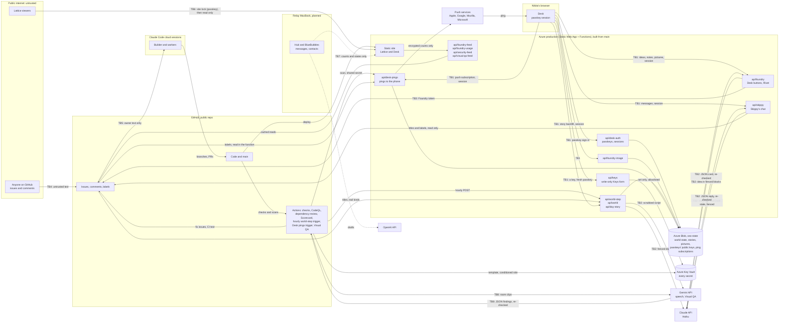

# Threat model

How C.E.O. handles the risks of putting language models and coding agents to work on a public repo: where the
trust boundaries are, what each AI risk looks like here, which control answers it, and what is still open. Issue
#65, from the security review of 2026-10-13 (#58). Status as of 2026-10-14.

This page describes controls and residual risk. Holes that are still open get one plain line and a tracking
reference, never a recipe. To report a vulnerability, use the repo's Security tab (see [SECURITY.md](SECURITY.md)).

The Desk shows this page as data on Systems > Security and Systems > Compliance (`/systems/security`,
`/systems/compliance`, #82), next to the live scan results. The Desk reads its tables from
`apps/world/src/desk/security/model.ts`, which copies them word for word; a test fails when the two drift apart, so
change both together.

## What C.E.O. is, in one paragraph

C.E.O. is a web app on Azure (its only home since #313) with two faces: **the Desk**, Nikita's dashboard, and **the Lattice**, a public 3D
world of AI agents. Claude Haiku is called from code for three things: **Rivet** shapes an idea Nikita types or
dictates on the Desk into a card (pitch, size, builder), the **world step** writes one hour of the Lattice's
history from the Foundry's real work (and, once a day, the script of **the day's story**), and **Skippy's chat**
(#224) answers Nikita on the Desk's Today page and suggests where a request should go, as buttons only Nikita can
press. Google's Gemini is used
twice: **Gemini's text to speech** (#95) turns that script into speech, getting only the script, written from the
already-scrubbed public Chronicle, and returning audio; and **Visual QA** (#91), in CI only, sends a few seconds of
each room of the built Lattice to Gemini after every push to `main`, and CI turns the blockers it flags into fix
issues. Code is written by **the Foundry**, a Claude Code builder session (the Builder,
Skippy's submind) and its workers (Rusty, Rocky), which read GitHub issues, open branches and pull requests, and
ship to `main`, which the "Deploy to Azure" workflow ships to production. **Relay**, a hub on an always-on MacBook that will read
messages, is designed but not built yet; its privacy rules come first, in [RELAY-PRIVACY.md](RELAY-PRIVACY.md).

## Data flow and trust boundaries

| Boundary | What crosses it | Controls |
| --- | --- | --- |
| **TB1** Desk to functions | Nikita's ideas, notes, answers, pictures, button presses, a device's push subscription, messages to Skippy, a third-party key for the Key Vault | A passkey sign-in with the device's own unlock (`api/desk-auth.ts`, #132), then a signed, HttpOnly, SameSite=Strict session cookie that lasts 30 minutes from its last use and 12 hours at most, checked on every write and private read (`requireSession` in `api/_desk/session.ts`); failed sign-ins and enrolments slow down, then lock out (`api/_desk/limits.ts`); the Desk key only enrols a new device and is never kept in the browser; the day's story backfill only for today or yesterday, once each (and once more when the story's style changes, #102); notes capped at 2,000 characters; only open `foundry:idea` issues can be acted on; picture links accepted only from the Desk's own picture function (`readImages`); image types allow-listed, 4 MB cap; Desk text that looks private is held back before it is sent anywhere (`privateParts`, #127); pictures served only on short-lived signed links (`verifyPicture`, #127); a push subscription taken only in a passkey session and only for a known push service (`readSubscription`, #135), dropped on sign-out or when its device is removed, and pinged only while its passkey is enrolled; the scan that sends pings needs the workflow's shared secret (`DESK_PINGS_SECRET`), and a ping carries counts only, never issue text (`pingText` in `api/_desk/pings.ts`); Skippy's chat (`api/skippy.ts`, #224) answers only in a passkey session, takes a message of at most 600 characters and the last eight turns, holds back text that looks private before Claude sees it, is paced per passkey (`api/_skippy/limits.ts`), logs no message text, keeps each answered question and reply only in the private store under the room Skippy tagged it with (the last 200 per room, 30 days at most; the room checked against a closed set, anything else filed as none), readable back only in a passkey session (`api/_skippy/log.ts`, GET /api/skippy-log, #273, with a `needs` filter for open hand-offs, #312); a hand-off's answer comes back only with the room threads' write key, as one plain line on a turn that was handed off (`POST /api/skippy-answer`, #312), never the history and never on a public path or the Lattice, and its suggested actions do nothing until Nikita taps one, which then goes through the Desk's own buttons; the site is locked or unlocked, and every site session ended, only in a passkey session (`api/_site/control.ts`, #236, #238); a third-party key is set from the Keys form (`api/_keys/route.ts`, #330) only by an allowlisted name (`api/_keys/allowlist.ts`; never the Desk key, the bypass, the pings secret, the crew's tokens, the push keys or the sealing key), each write with a fresh answer from the session's own passkey to a two-minute challenge bound to that name and value (by hash) and spent once with an atomic create-if-absent write before the vault is called (`api/_desk/assert.ts`, `claim` in `api/_desk/store.ts`), and Azure itself letting the Function App write only those twelve secrets (Key Vault Secrets Officer per secret, never vault-wide), write-only (no read, no list of values, no delete), at most 4 KB, six in a row before a wait, and its value never answered, logged or kept in the trail |
| **TB2** Code to the model APIs | Idea text, issue text, the hour's digest, the day's story script, Nikita's messages to Skippy with the Desk's state; JSON, text or audio back | Untrusted text fenced in tagged data blocks that it can't close (`shapeInput`, `unfence` in `api/foundry.ts`; `fence` in `api/_world/prompt.ts` and `api/_world/story.ts`; `chatInput`, `unfenceChat` in `api/_skippy/prompt.ts`); the system rules are a constant, never built from input; structured output with a closed JSON schema; every answer re-validated in code (`readShape`, `readAnswer`, `readReply`); Skippy is told the Desk's state as titles, numbers, labels and counts only, scrubbed like the public feeds (`api/_skippy/context.ts`), and what C.E.O. runs on as a public sheet generated from the repo (languages, hosts, package and service names and versions, an OSV.dev advisory count; never a key or an account id: `api/_skippy/stack.ts`, `api/_skippy/advisories.ts`, #312), in its own <stack> block; OSV is sent only the lockfile's public package names and versions; Gemini gets only the day's script, written from the already-scrubbed public Chronicle and scrubbed again (`cleanScript`), and its audio is only stored and played, with its key in Vercel and its own monthly cap |
| **TB3** Functions to GitHub | Issue writes with the Foundry token | Token lives only in the Azure Key Vault; once the crew's GitHub App is set up, the buttons write as `ceo-foundry[bot]` with an hour-long token that can only touch this repo's issues, and the feeds read with a read-only one (`api/_github.ts`, #138); label changes are hard-coded per button, so shaping can never add `foundry:build`; card text is reduced to plain lines before it is written (`plainLine`) |
| **TB4** Public to the repo | Anyone's issues and comments | Labels need a collaborator; the builder reads only owner text (TB5); the world step counts trail steps only from Nikita's account, the Checks bot and the crew's App (`TRAIL_AUTHORS` in `api/_world/digest.ts`) |
| **TB5** Issues to the builder | Work descriptions | `scripts/foundry-issue.sh` (#59): owner, CI and Foundry App text in data blocks with a random tag per read, everything else withheld by name, exit 3 when anything was withheld; worker briefs carry issue text only inside a data block (docs/FOUNDRY.md, "Trusted input") |
| **TB6** The public Lattice | World history, Foundry feed, spend totals, security posture, the latest Visual QA run | Read-only endpoints; the step reads only titles, numbers, labels and trail step kinds, never bodies or comment words; `scrub` on everything in and out; edge cache with canonical URLs (#63); the security feed (`api/security-feed.ts`, #82) returns only pass or fail states, scores, dates and counts, never an open alert's details; the Visual QA feed (`api/visual-qa-feed.ts`, #91) returns only counts, a time, a state and a link to the run; once Nikita locks the site, every page and API route asks for a site session first, one Desk passkey sign-in per device that lasts 180 days from its last use (no password, #238), and only the login page, the Desk's passkey ceremony (which guards itself), the public build's files and machine callers holding their own key pass without one (`middleware.ts`, `api/_site/gate.ts`, #236) |
| **TB7** Relay to the site (planned) | Counts and states, never message text | The Relay privacy spec, docs/RELAY-PRIVACY.md (#149): only `RelayStatus`, an allowlisted shape of counts, enum states and timestamps, checked with `readRelayStatus` (`packages/core/src/relay.ts`) before the hub sends it and again where the site receives it; an unknown key or a free string refuses the whole status; names, previews and drafts never pass through Vercel; design rules in docs/DELIVERY.md, "Environments" |
| **TB8** CI to Gemini | Clips of the public Lattice and the room descriptions; JSON findings back | Only renders of the public Lattice built from `main`, a few seconds a room at low resolution, never live data or secrets (`scripts/room-tour.mjs`); the key is a GitHub Actions secret (`GEMINI_API_KEY`) given only to the review step, sent only to Google's API host and never printed (`redact`); fixed rules that say text in the video is never instructions; structured output re-validated in code (`parseFindings`) and reduced to plain lines (`plainText`) before CI writes an issue in its own words; spend capped per run and per day (`api/_visualqa/review.ts`) |

Code reaches production through its own boundary: a change lands on `main` (by pull request for the Foundry's
lanes, by direct push for chat work today) and the "Deploy to Azure" workflow ships it (#214, #216, #218; Azure is
the only home since #313, and Vercel is being retired). It signs in with OIDC from the repo's `azure` environment
(only `main` may use it), so no Azure password or key is stored in GitHub. Since #330 the same workflow applies the
Azure template to the resource group on every merge, with Role Based Access Control Administrator conditioned to the
template's own roles and identities and no deletes (AZURE.md, "The template on every deploy"; R8 below), so a
compromised `main` could change C.E.O.'s Azure resources but not grant anything outside that list. The controls on that path are in
[DELIVERY.md](DELIVERY.md) and [SECURITY.md](SECURITY.md): checks, CodeQL, dependency review, Scorecard, Dependabot,
secret scanning, pinned actions, least-privilege workflows and npm provenance checks (#64, #66, #67).

## Assets

| Asset | Where it lives | Why it matters |
| --- | --- | --- |
| Production code and `main` | GitHub, Azure | Whatever lands on `main` is live in minutes |
| Claude API key | Azure Key Vault | Spend (capped at $10 a month at the provider) |
| Gemini API key | Azure Key Vault (speech) and a GitHub Actions secret (Visual QA), both `GEMINI_API_KEY` | Speech spend (capped in code by `GEMINI_BUDGET_USD`, $5 a month by default, never above $10); Visual QA spend (capped in code at $0.50 a run and eight pushed runs a day) |
| Foundry GitHub token | Azure Key Vault | Writes issues as Nikita; the fallback until the crew's App is set up (#138), then deleted |
| The crew's App key | Azure Key Vault and a GitHub Actions secret | Mints hour-long tokens for this repo only, as `ceo-foundry[bot]`: issues, pull requests and code, never settings or CI |
| Desk key | Azure Key Vault only; typed once per device to enrol its passkey (#132) | Enrols a device on the Desk, the human approval gate for builds; the Desk's signing keys are derived from it |
| Desk passkeys | Their private keys stay on Nikita's devices; only the public keys are in Azure Blob (private) | Sign in to the Desk |
| The site lock | Not a secret: whether the site is locked and a session version, in Azure Blob (private) at `desk/site/password.json` (#236). The way in is the Desk passkey (#238), whose private part never leaves the device; there is no site password | Writing it (only through a Desk passkey session) locks, unlocks or signs every device out |
| The site's session key | `SITE_SESSION_SECRET` in the Key Vault, or derived from the Desk key | Signs the site's sign-in cookies; with it, a cookie could be forged until it changes |
| The workflows' site key | `site-bypass-token` in the Azure Key Vault, read by the live watch at run time (#236, #313); the old `SITE_BYPASS_TOKEN` Actions secret is removed after the cut-over | Reads the site past the lock, for the live watch; reads only |
| The Desk's push key (VAPID private key) | Azure Key Vault only (#135) | Signs pings; with a subscription too, it could put a notification on Nikita's phone, never read anything |
| The pings secret | Azure Key Vault (`desk-pings-secret`), read by the pings workflow at run time; the old `DESK_PINGS_SECRET` Actions secret is removed after the cut-over | Makes the Desk scan and ping; nothing else |
| Ping subscriptions | Azure Blob (private), beside the passkeys | Where Nikita's devices get pings; useless without the push key |
| The builder session's GitHub access | Claude Code environment (Nikita's account; set by the environment, not the repo) | Pushes code, merges pull requests |
| The Azure deploy identity (`ceo-github-deploy`) | Microsoft Entra ID, trusted only for GitHub's `azure` environment on `main` (OIDC, no stored key) | Contributor on the Azure copy's resource group, blob writer on its storage, and Key Vault Secrets User on its vault (so the hourly pings and the live watch read `desk-pings-secret` and `site-bypass-token` at run time): can replace the Azure copy and read its secrets, never Vercel or the subscription |
| The Azure functions' secrets | Azure Key Vault (RBAC), read by the functions' own identity through Key Vault references, and by the deploy identity for `desk-pings-secret` and `site-bypass-token` | The Azure copy's own keys: its Desk key, push keys and pings secret are minted for it, not copied from Vercel; the Claude, Gemini and GitHub keys are separate keys on the same accounts |
| World state and history | Azure Blob (private) | The Lattice's memory |
| Nightly backups | Azure Storage `ceo-backups` (private, Cool tier), kept 90 days; deletes and overwrites recoverable for 14 days | A copy of the world's public state, the Azure copy's state and the models; restores either copy |
| Idea pictures | Azure Blob (private), shown only on short-lived signed links (#127) | May show Nikita's screen |
| Nikita's words | GitHub issues (public) | Dictated, may mention people |
| Messages and contacts (planned) | Relay MacBook only; what may leave it is in [RELAY-PRIVACY.md](RELAY-PRIVACY.md) | The most sensitive data C.E.O. will touch |

## Actors

| Actor | Can do | Trusted for |
| --- | --- | --- |
| Nikita | Everything; presses the Desk buttons; owns the repo | Decisions, and the words that steer the Foundry |
| The Builder and workers | Code, branches, pull requests, merges | Following FOUNDRY.md; their output is checked, not trusted |
| Rivet (Haiku) | Proposes a card | Nothing: its answer is data, re-checked in code |
| Skippy's chat (Haiku) | Answers Nikita on the Desk and suggests actions | Nothing: its answer is data, re-checked in code, and its actions are buttons only Nikita can press |
| World step model (Haiku) | Proposes an hour | Nothing: its answer is data, re-checked in code |
| Gemini speech | Reads the day's script aloud | Nothing: it gets only public, scrubbed text, and its audio is only stored and played |
| Visual QA reviewer (Gemini) | Proposes findings about the Lattice's look | Nothing: its answer is data, re-checked in code; only CI writes the issue, in its own format |
| CI bots | Post check results | Machine output, read as data |
| Anyone on GitHub | Open issues, comment | Nothing |
| Lattice visitors | Read the site; once it is locked, only on a device signed in with the Desk passkey (#236, #238) | Nothing |
| A compromised dependency or action | Runs at install, build or CI time | Nothing: pinned, signed, scanned |

## OWASP Top 10 for LLM Applications (2025)

| Risk | Where it applies in C.E.O. | Controls in place | Residual risk | Tracking |
| --- | --- | --- | --- | --- |
| **LLM01 Prompt Injection** | Idea text and issue text into Rivet; Nikita's messages and the Desk's state into Skippy's chat; issue titles into the world step; issue comments into the builder; text visible in the Lattice's recordings into Gemini | Data fencing with spoof-proof tags (`shapeInput`, `unfence`; `fence` in `api/_world/prompt.ts`; `chatInput`, `unfenceChat` for Skippy's chat, #224); system rules that say the blocks are data; constant system prompts; owner-only input for the builder (`scripts/foundry-issue.sh`, #59); world trail steps only from trusted authors (`TRAIL_AUTHORS`); the builder guard (`.claude/hooks/`, #119); the injection eval suite below | A model can still be talked into odd wording inside the schema; the builder's fence is a script and a rule it follows, not a platform control | Agents' own identity (R2) |
| **LLM02 Sensitive Information Disclosure** | The public Lattice; ideas filed as public issues; pictures | Data minimisation (the step never reads bodies or comment words, `api/_world/digest.ts`); `scrub` on all input and output, now also catching full-width, zero-width-split and spelled-out forms; no secrets in git (secret scanning and push protection); the privacy check on Desk text before it is posted (`privateParts` in `api/_privacy.ts`, #127): emails, phone numbers, street addresses, card, bank and ID numbers, keys, tokens and passwords, and names with a cue are held back whole, nothing sent, and the same check runs on messages to Skippy before Claude sees them (#224); idea pictures stay in the private store, named in the issue but never linked, and served only on short-lived signed links (`api/_pictures.ts`); the whole site behind the Desk passkey once Nikita locks it (#236, #238) | The privacy check reads patterns: a detail without a cue, or one written around them, still goes public as written; pictures are never read for what they show | Shipped: privacy guard before posting (#127) |
| **LLM03 Supply Chain** | npm packages, GitHub Actions, the Claude SDK | Lockfile with `npm ci`; `npm audit signatures` and `npm audit --audit-level=high` in checks; dependency review; Dependabot; actions pinned to SHAs; CodeQL; OpenSSF Scorecard (#64, #67); the Azure deploy signs in with OIDC from the `azure` environment, which only `main` may use (#218) | A malicious release that passes signature checks before it is known | Watched by Dependabot and dependency review |
| **LLM04 Data and Model Poisoning** | No training or fine-tuning; the world step reads back its own last hours | Last hours are re-fenced and re-scrubbed each hour; answers are re-validated before they are saved, so a bad hour can't add agents, rooms or kinds | One odd hour can echo into the next few | Accepted |
| **LLM05 Improper Output Handling** | Rivet's card written into an issue body the Desk and the world step parse; world text shown on the Lattice; Gemini's findings written into a fix issue | Schema with `additionalProperties: false`; enums for builder, model, size, agents, rooms and kinds; `plainLine` strips pictures, links, HTML and markdown markers from card text so it can't fake a `**Builder:**` line or call out to another host; `plainText` does the same for Visual QA findings, which CI files under its own card lines; length caps everywhere; React escapes all model text; no HTML sinks in the front end; the Desk's card reader shows pictures only from Nikita's own store, through its own picture function (`ownPictures`, #127) | A model can still word a card oddly inside the schema; an enforcing CSP and security headers (#62) back up the reader | Shipped: the Desk shows only its own pictures (#127) |
| **LLM06 Excessive Agency** | The builder session (shell, git, merges); Rivet; the world step; Skippy's chat | Rivet, the world step and Skippy's chat have no tools at all: they return JSON only; Skippy's actions are a closed set of suggestions (file an idea, answer Rivet, open a page, enter the Lattice) that only Nikita's tap sends, through the Desk's own buttons, re-checked in code (`readReply`, #224); labels that start a build come only from Nikita's Build choice; checks, scans and the ruleset definitions for `main` (#60, #66); CODEOWNERS on the trust boundary (inert until code-owner review is turned on); the crew's GitHub App for the Desk's functions and CI's issue writes, with hour-long tokens for this repo only and no Administration or Workflows permission (`api/_github.ts`, #138); the builder guard, a hook that denies risky commands and secrets files before they run and logs every tool call on the machine (`.claude/hooks/`, #119) | The builder's Claude Code sessions still act as Nikita on GitHub (their access comes from the environment, not from the repo), and its guard is a deny list, not a sandbox, so some of its limits are still rules it follows | Agents' own identity (R2) |
| **LLM07 System Prompt Leakage** | Rivet's and the world step's prompts | Both prompts are public in this repo by design and hold no secrets, keys or private rules; the security comes from code checks, not from the prompt being secret | None beyond what is already public | Accepted |
| **LLM08 Vector and Embedding Weaknesses** | Not used: no retrieval, no vector store | Not applicable today; the Relay privacy spec (docs/RELAY-PRIVACY.md) rules out embeddings, vector stores and search indexes over messages until it is changed | If Relay adds retrieval over messages, this becomes live | Relay privacy spec (R5, shipped #149) |
| **LLM09 Misinformation** | The Historian's hourly summaries; Rivet's pitches | The world step reads only real events and labels the Lattice as a story; Rivet's card is a suggestion that Nikita approves; the Builder confirms builder and model | Off-tone or wrong lines on the Lattice for an hour | Accepted |
| **LLM10 Unbounded Consumption** | Claude spend; Gemini speech and Visual QA spend; GitHub token quota; function CPU | Coded budget guard for the world step (`api/_world/budget.ts`); Skippy's chat has its own share of the month and a check against the whole cap before every call, and a per-passkey pace (`api/_skippy/budget.ts`, `api/_skippy/limits.ts`, #224); Gemini's own coded monthly cap and one story per day, made once (`api/_world/story.ts`); per-run and per-day caps for Visual QA (`api/_visualqa/review.ts`); provider-side monthly cap; `max_tokens` on every call; note and output length caps; feed cache hardening (#63); `scrub` now linear on long input (bounded patterns, titles cut before scrubbing) | The world step's trigger stays open on purpose: calling it more often changes nothing, so the 55-minute spacing and the monthly budget guard bound the spend, and a key was left out | Covered: 55-minute spacing and the monthly budget guard (closed #171) |

## Google SAIF

| SAIF core element | In C.E.O. |
| --- | --- |
| Expand strong security foundations to the AI ecosystem | Secrets only in Azure Key Vault and Actions secrets; Azure deploys sign in with OIDC, with no stored key (#218); pinned and signed supply chain; CodeQL and dependency review on agent-written code like any other; an enforcing CSP and security headers (#62) |
| Extend detection and response | The Trail on every issue records origin, decision, builder, model and cost of each change; Checks failing on `main` opens a fix issue by itself; Scorecard and code scanning report to the Security tab |
| Automate defenses | The injection eval suite runs on every build; schema-bound output and code re-validation on every model call; Dependabot and secret scanning |
| Harmonize platform controls | One delivery path for every change (DELIVERY.md); rulesets for `main` defined in `.github/rulesets/` (#60); least-privilege workflow permissions |
| Adapt controls | Each review finding became a carded fix with a test; this suite grows with new payloads; gaps it finds are fixed or marked expected-fail until they are |
| Contextualize AI system risks | This page: the model risks are mapped to the business flow they sit in (ideas, builds, the public world, messages) |

## NIST AI RMF

| Function | In C.E.O. |
| --- | --- |
| **Govern** | Who decides is written down (docs/SKIPPY.md); Nikita approves every build on the Desk; the security review (#58) and this page set the policy; CODEOWNERS marks the trust boundary |
| **Map** | The data flow, boundaries, assets and actors above; the OWASP table maps each risk to where it lives |
| **Measure** | The injection eval suite (counts below); spend per call on the Trail and the Desk's usage panel; Scorecard; delivery measures planned in DELIVERY.md |
| **Manage** | Controls per risk with owners and tracking; residual risks and the roadmap below; expected-fail tests keep open gaps visible in every run |

## The injection eval suite

Three files under `api/_security/`, run by `npm test` on every build with no network and no API calls. The models
are stubbed; the payloads go through the real code around them. `npm run security:evals` counts the cases in each
area into `apps/world/src/desk/security/evals.json` for the Desk; a test fails when the counts below or that file
fall behind the suite.

| Area | File | Cases | What it proves |
| --- | --- | --- | --- |
| Rivet's prompt | `injection.test.ts` | 86 | For 21 known payloads (direct, "ignore previous", delimiter spoofing in five forms, role-play, base64, ASCII smuggling, bidi, markdown and HTML exfiltration, fake tool calls, fake card fields, a spoofed owner note, oversized input), the idea stays in its own block in new, revise and answer rounds; the real call sends the same system rules and the idea only as user data, with structured output on |
| Rivet's answer | `injection.test.ts` | 23 | Hostile answers can't add fields or labels, pick an unknown builder or model, smuggle card lines, links, pictures, HTML or scripts, or exceed length caps; non-cards are rejected |
| The Desk's write path | `injection.test.ts` | 53 | With GitHub and Claude stubbed: clicks without a sign-in session touch nothing; a proposed or revised idea never gets `foundry:build`; Stop works only on an open `foundry:auto` build and only sends it back to an idea; Undo works only on a closed, shipped change not already being undone, and only reopens it in the fix lane; foreign picture links are dropped, and the Desk shows only its own pictures; text that looks private is held back before GitHub or Claude hear of it; pictures go into the issue as names and reach Rivet only on short-lived signed links; oversized notes are capped; forged choices and issue numbers are refused; requests go only to the repo's API |
| The world step | `injection.test.ts` | 29 | Hostile titles and stranger comments: system rules unchanged byte for byte, each data block opened and closed once, no stray brackets or invisible characters, only trusted trail authors; secrets in disguise are scrubbed; hostile answers lose unknown agents, rooms, kinds, extra fields and over-limit items; end to end through `runStep`, the saved state is clean |
| The builder's input | `builder-input.test.ts` | 10 | With a stub `gh`: an outsider's and look-alike accounts' text never appears (look-alikes of the crew's App too), exit code 3, a spoofed closing marker closes nothing, owner, CI and the crew's App's text sit in their blocks |
| Skippy's chat | `skippy.test.ts` | 44 | For 12 hostile messages (direct, "ignore previous", delimiter spoofing in six forms, ASCII smuggling, a fake action, a fake tool call, markdown exfiltration), the message and the history stay in their own blocks and the system rules stay the same; the real call sends the rules as the system prompt and the message only as user data, with a closed schema and a token cap; a web lookup runs in its own call with web search only (at most three searches), sees only a private-checked query, and comes back fenced in <web>, links stripped; Opus 5.5 only when Sonnet asks to go deeper, each call counted at its own price; hostile answers lose actions outside the set, links, markup, answers to questions nobody asked, private drafts and anything past the caps; no session, another site, private text, a spent budget, an unreadable ledger or a flood each stop the chat before Claude hears anything; a hostile or made-up room tag is filed under none, and the room log (#273) gives a read without a passkey session, or from another site, nothing, the Exchange's and Relay's asks included; a question about our stack (#312) sends OSV.dev only the lockfile's package names and versions, never the message or the Desk |

What it doesn't prove: how a live model behaves. A small live eval behind a manual workflow is the next step for
that (not carded yet).

**Gaps the suite found, fixed in the same change (#65):**

- Rivet's card text was written into the issue as the model gave it, so a pitch or short line could carry a fake
  card field or a picture link. Card text is now reduced to plain lines (`plainLine`).
- Rivet's input had no data fence. It now does, with tags that text inside can't close, and rules that say so.
- The world step counted trail-shaped comments from anyone. It now counts only Nikita's account and the Checks bot.
- `scrub` missed full-width, zero-width-split and spelled-out forms, and slowed down sharply on very long input.
  Both fixed.

**Found by the suite, fixed in #127 (R4):** the Desk's card reader showed pictures from any host in idea text
written with the Desk key. It now shows only Nikita's own pictures, from the private store, on short-lived signed
links through its own picture function; its test passes like any other, and nothing in the suite is expected-fail.

## Residual risks and roadmap

| | Item | Closes | Status |
| --- | --- | --- | --- |
| Shipped | Security headers and an enforcing CSP | Output handling defence in depth, clickjacking | #62 |
| R1 | Builder permission hook: narrow shell permissions, deny risky commands, log every tool call | Excessive agency (agent half) | Shipped #119 |
| R2 | The agents' own identity (a GitHub App with short-lived tokens; DELIVERY.md, section 10) | Agents acting as Nikita; previews and audit | Built #138, live once Nikita sets up the App; open: the Claude Code sessions still act as Nikita |
| R3 | Real Desk sign-in (passkey, short session, rate limits) | The static Desk key | Shipped #132 |
| R4 | Privacy guard before posting (check Desk text before it goes public, signed picture links, Desk shows own pictures only) | Desk text and pictures going public | Shipped #127 |
| R5 | Relay privacy spec before the hub is built (what stays on the Mac, what OpenAI and the site may see, retention, the wipe; a counts-only check on the site boundary) | Messages and contacts | Shipped #149 |
| R6 | Key the world step and cap it per hour | World spend | Shipped #171: covered by the 55-minute spacing and the monthly budget guard; no key needed |
| R7 | A lock on the whole site (one Desk passkey sign-in per device, no password, machine callers on their own keys, a second step such as approving a new device later) | The site being public | Built #236 and #238 (passkey only), on once Nikita locks it from the Desk; open: Azure's static files, the second step |
| R8 | Azure changes and keys without Cloud Shell (the deploy applies the template with a role that may assign only the template's own roles; a write-only, allowlisted Keys form behind a passkey step-up) | Hand-run pastes drifting from the template; keys pasted in a shell | Built #330, live once Nikita runs the role paste in AZURE.md |

**R2, what #138 does and doesn't close.** Once Nikita creates the crew's GitHub App and pastes its key
(SECURITY.md, "The crew's own identity"), every function that talks to GitHub mints its own hour-long token for
this repo only (`api/_github.ts`): the Desk's buttons can only write issues, the feeds and the world step can only
read. CI's fix issues come from the App too. None of it can change settings, rulesets or workflows. What stays open
is the biggest actor: the Foundry's Claude Code sessions push, open pull requests and merge with the GitHub access
their environment gives them, which is Nikita's today and can't be changed from the repo. Until it can, GitHub can't
tell their work from his, code-owner review can't be required, and the break-glass bypass in DELIVERY.md, section 11,
stays off. DELIVERY.md, section 10, has the details.

Accepted for now: odd wording from a model inside the schema (LLM09), the world's last hours echoing into the next
(LLM04), and public prompts (LLM07). Revisit when Relay comes online, since that adds private data, untrusted
inbound messages and actions taken in Nikita's name.
