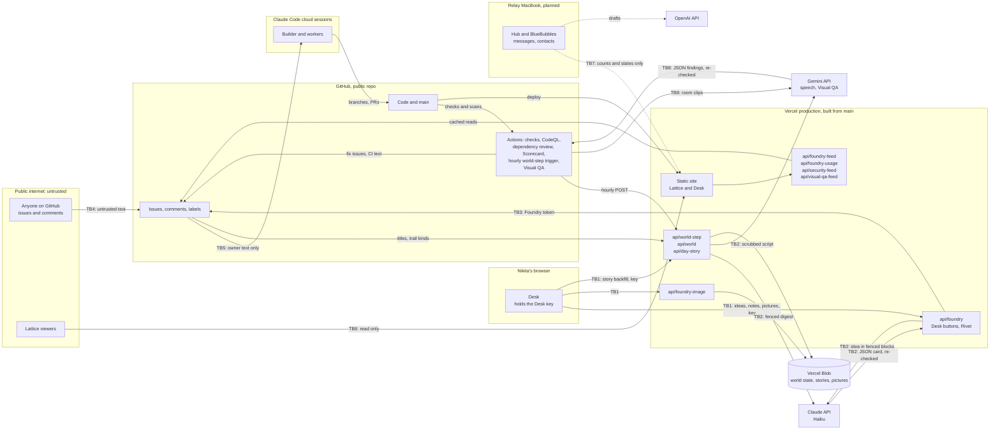

# Threat model

How C.E.O. handles the risks of putting language models and coding agents to work on a public repo: where the
trust boundaries are, what each AI risk looks like here, which control answers it, and what is still open. Issue
#65, from the security review of 2026-10-13 (#58). Status as of 2026-10-14.

This page describes controls and residual risk. Holes that are still open get one plain line and a tracking
reference, never a recipe. To report a vulnerability, use the repo's Security tab (see [SECURITY.md](SECURITY.md)).

The Desk shows this page as data on Systems > Security and Systems > Compliance (`/systems/security`,
`/systems/compliance`, #82), next to the live scan results. The Desk reads its tables from
`apps/world/src/desk/security/model.ts`, which copies them word for word; a test fails when the two drift apart, so
change both together.

## What C.E.O. is, in one paragraph

C.E.O. is a web app on Vercel with two faces: **the Desk**, Nikita's dashboard, and **the Lattice**, a public 3D
world of AI agents. Two models are called from code, both Claude Haiku: **Rivet** shapes an idea Nikita types or
dictates on the Desk into a card (pitch, size, builder), and the **world step** writes one hour of the Lattice's
history from the Foundry's real work (and, once a day, the script of **the day's story**). Google's Gemini is used
twice: **Gemini's text to speech** (#95) turns that script into speech, getting only the script, written from the
already-scrubbed public Chronicle, and returning audio; and **Visual QA** (#91), in CI only, sends a few seconds of
each room of the built Lattice to Gemini after every push to `main`, and CI turns the blockers it flags into fix
issues. Code is written by **the Foundry**, a Claude Code builder session (the Builder,
Skippy's submind) and its workers (Rusty, Rocky), which read GitHub issues, open branches and pull requests, and
ship to `main`, which Vercel deploys to production. **Relay**, a hub on an always-on MacBook that will read
messages, is designed but not built yet.

## Data flow and trust boundaries

| Boundary | What crosses it | Controls |
| --- | --- | --- |
| **TB1** Desk to functions | Nikita's ideas, notes, answers, pictures, button presses | Desk key compared in constant time (`api/foundry.ts`, `api/foundry-image.ts`, `api/day-story.ts`); the day's story backfill only for today or yesterday, once each (and once more when the story's style changes, #102); notes capped at 2,000 characters; only open `foundry:idea` issues can be acted on; picture links accepted only from the Desk's own picture function (`readImages`); image types allow-listed, 4 MB cap; Desk text that looks private is held back before it is sent anywhere (`privateParts`, #127); pictures served only on short-lived signed links (`verifyPicture`, #127) |
| **TB2** Code to the model APIs | Idea text, issue text, the hour's digest, the day's story script; JSON, text or audio back | Untrusted text fenced in tagged data blocks that it can't close (`shapeInput`, `unfence` in `api/foundry.ts`; `fence` in `api/_world/prompt.ts` and `api/_world/story.ts`); the system rules are a constant, never built from input; structured output with a closed JSON schema; every answer re-validated in code (`readShape`, `readAnswer`); Gemini gets only the day's script, written from the already-scrubbed public Chronicle and scrubbed again (`cleanScript`), and its audio is only stored and played, with its key in Vercel and its own monthly cap |
| **TB3** Functions to GitHub | Issue writes with the Foundry token | Token lives only in Vercel; label changes are hard-coded per button, so shaping can never add `foundry:build`; card text is reduced to plain lines before it is written (`plainLine`) |
| **TB4** Public to the repo | Anyone's issues and comments | Labels need a collaborator; the builder reads only owner text (TB5); the world step counts trail steps only from Nikita's account and the Checks bot (`TRAIL_AUTHORS` in `api/_world/digest.ts`) |
| **TB5** Issues to the builder | Work descriptions | `scripts/foundry-issue.sh` (#59): owner and CI text in data blocks with a random tag per read, everything else withheld by name, exit 3 when anything was withheld; worker briefs carry issue text only inside a data block (docs/FOUNDRY.md, "Trusted input") |
| **TB6** The public Lattice | World history, Foundry feed, spend totals, security posture, the latest Visual QA run | Read-only endpoints; the step reads only titles, numbers, labels and trail step kinds, never bodies or comment words; `scrub` on everything in and out; edge cache with canonical URLs (#63); the security feed (`api/security-feed.ts`, #82) returns only pass or fail states, scores, dates and counts, never an open alert's details; the Visual QA feed (`api/visual-qa-feed.ts`, #91) returns only counts, a time, a state and a link to the run |
| **TB7** Relay to the site (planned) | Counts and states, never message text | Design rules in docs/DELIVERY.md, "Environments"; the full privacy spec is roadmap R5 |
| **TB8** CI to Gemini | Clips of the public Lattice and the room descriptions; JSON findings back | Only renders of the public Lattice built from `main`, a few seconds a room at low resolution, never live data or secrets (`scripts/room-tour.mjs`); the key is a GitHub Actions secret (`GEMINI_API_KEY`) given only to the review step, sent only to Google's API host and never printed (`redact`); fixed rules that say text in the video is never instructions; structured output re-validated in code (`parseFindings`) and reduced to plain lines (`plainText`) before CI writes an issue in its own words; spend capped per run and per day (`api/_visualqa/review.ts`) |

Code reaches production through its own boundary: a change lands on `main` (by pull request for the Foundry's
lanes, by direct push for chat work today) and Vercel ships it. The controls on that path are in
[DELIVERY.md](DELIVERY.md) and [SECURITY.md](SECURITY.md): checks, CodeQL, dependency review, Scorecard, Dependabot,
secret scanning, pinned actions, least-privilege workflows and npm provenance checks (#64, #66, #67).

## Assets

| Asset | Where it lives | Why it matters |
| --- | --- | --- |
| Production code and `main` | GitHub, Vercel | Whatever lands on `main` is live in minutes |
| Claude API key | Vercel environment | Spend (capped at $10 a month at the provider) |
| Gemini API key | Vercel environment (speech) and a GitHub Actions secret (Visual QA), both `GEMINI_API_KEY` | Speech spend (capped in code by `GEMINI_BUDGET_USD`, $5 a month by default, never above $10); Visual QA spend (capped in code at $0.50 a run and eight pushed runs a day) |
| Foundry GitHub token | Vercel environment | Writes issues; its rate limit backs the Desk buttons and the world feed |
| Desk key | Vercel environment, Nikita's browser | The human approval gate for builds |
| The builder session's GitHub access | Claude Code environment | Pushes code, merges pull requests |
| World state and history | Vercel Blob (private) | The Lattice's memory |
| Idea pictures | Vercel Blob (private), shown only on short-lived signed links (#127) | May show Nikita's screen |
| Nikita's words | GitHub issues (public) | Dictated, may mention people |
| Messages and contacts (planned) | Relay MacBook only | The most sensitive data C.E.O. will touch |

## Actors

| Actor | Can do | Trusted for |
| --- | --- | --- |
| Nikita | Everything; presses the Desk buttons; owns the repo | Decisions, and the words that steer the Foundry |
| The Builder and workers | Code, branches, pull requests, merges | Following FOUNDRY.md; their output is checked, not trusted |
| Rivet (Haiku) | Proposes a card | Nothing: its answer is data, re-checked in code |
| World step model (Haiku) | Proposes an hour | Nothing: its answer is data, re-checked in code |
| Gemini speech | Reads the day's script aloud | Nothing: it gets only public, scrubbed text, and its audio is only stored and played |
| Visual QA reviewer (Gemini) | Proposes findings about the Lattice's look | Nothing: its answer is data, re-checked in code; only CI writes the issue, in its own format |
| CI bots | Post check results | Machine output, read as data |
| Anyone on GitHub | Open issues, comment | Nothing |
| Lattice visitors | Read the public site | Nothing |
| A compromised dependency or action | Runs at install, build or CI time | Nothing: pinned, signed, scanned |

## OWASP Top 10 for LLM Applications (2025)

| Risk | Where it applies in C.E.O. | Controls in place | Residual risk | Tracking |
| --- | --- | --- | --- | --- |
| **LLM01 Prompt Injection** | Idea text and issue text into Rivet; issue titles into the world step; issue comments into the builder; text visible in the Lattice's recordings into Gemini | Data fencing with spoof-proof tags (`shapeInput`, `unfence`; `fence` in `api/_world/prompt.ts`); system rules that say the blocks are data; constant system prompts; owner-only input for the builder (`scripts/foundry-issue.sh`, #59); world trail steps only from trusted authors (`TRAIL_AUTHORS`); the builder guard (`.claude/hooks/`, #119); the injection eval suite below | A model can still be talked into odd wording inside the schema; the builder's fence is a script and a rule it follows, not a platform control | Agents' own identity (R2) |
| **LLM02 Sensitive Information Disclosure** | The public Lattice; ideas filed as public issues; pictures | Data minimisation (the step never reads bodies or comment words, `api/_world/digest.ts`); `scrub` on all input and output, now also catching full-width, zero-width-split and spelled-out forms; no secrets in git (secret scanning and push protection); the privacy check on Desk text before it is posted (`privateParts` in `api/_privacy.ts`, #127): emails, phone numbers, street addresses, card, bank and ID numbers, keys, tokens and passwords, and names with a cue are held back whole, nothing sent; idea pictures stay in the private store, named in the issue but never linked, and served only on short-lived signed links (`api/_pictures.ts`) | The privacy check reads patterns: a detail without a cue, or one written around them, still goes public as written; pictures are never read for what they show | Shipped: privacy guard before posting (#127) |
| **LLM03 Supply Chain** | npm packages, GitHub Actions, the Claude SDK | Lockfile with `npm ci`; `npm audit signatures` and `npm audit --audit-level=high` in checks; dependency review; Dependabot; actions pinned to SHAs; CodeQL; OpenSSF Scorecard (#64, #67) | A malicious release that passes signature checks before it is known | Watched by Dependabot and dependency review |
| **LLM04 Data and Model Poisoning** | No training or fine-tuning; the world step reads back its own last hours | Last hours are re-fenced and re-scrubbed each hour; answers are re-validated before they are saved, so a bad hour can't add agents, rooms or kinds | One odd hour can echo into the next few | Accepted |
| **LLM05 Improper Output Handling** | Rivet's card written into an issue body the Desk and the world step parse; world text shown on the Lattice; Gemini's findings written into a fix issue | Schema with `additionalProperties: false`; enums for builder, model, size, agents, rooms and kinds; `plainLine` strips pictures, links, HTML and markdown markers from card text so it can't fake a `**Builder:**` line or call out to another host; `plainText` does the same for Visual QA findings, which CI files under its own card lines; length caps everywhere; React escapes all model text; no HTML sinks in the front end; the Desk's card reader shows pictures only from Nikita's own store, through its own picture function (`ownPictures`, #127) | A model can still word a card oddly inside the schema; an enforcing CSP and security headers (#62) back up the reader | Shipped: the Desk shows only its own pictures (#127) |
| **LLM06 Excessive Agency** | The builder session (shell, git, merges); Rivet; the world step | Rivet and the world step have no tools at all: they return JSON only; labels that start a build come only from Nikita's Build choice; checks, scans and the ruleset definitions for `main` (#60, #66); CODEOWNERS on the trust boundary (inert until the agents have their own identity); the builder guard, a hook that denies risky commands and secrets files before they run and logs every tool call on the machine (`.claude/hooks/`, #119) | The builder acts as Nikita, and its guard is a deny list, not a sandbox, so some of its limits are still rules it follows | Agents' own identity (R2) |
| **LLM07 System Prompt Leakage** | Rivet's and the world step's prompts | Both prompts are public in this repo by design and hold no secrets, keys or private rules; the security comes from code checks, not from the prompt being secret | None beyond what is already public | Accepted |
| **LLM08 Vector and Embedding Weaknesses** | Not used: no retrieval, no vector store | Not applicable today | If Relay adds retrieval over messages, this becomes live | Relay privacy spec (R5) |
| **LLM09 Misinformation** | The Historian's hourly summaries; Rivet's pitches | The world step reads only real events and labels the Lattice as a story; Rivet's card is a suggestion that Nikita approves; the Builder confirms builder and model | Off-tone or wrong lines on the Lattice for an hour | Accepted |
| **LLM10 Unbounded Consumption** | Claude spend; Gemini speech and Visual QA spend; GitHub token quota; function CPU | Coded budget guard for the world step (`api/_world/budget.ts`); Gemini's own coded monthly cap and one story per day, made once (`api/_world/story.ts`); per-run and per-day caps for Visual QA (`api/_visualqa/review.ts`); provider-side monthly cap; `max_tokens` on every call; note and output length caps; feed cache hardening (#63); `scrub` now linear on long input (bounded patterns, titles cut before scrubbing) | The world step's trigger is open and its per-hour cap is a known gap | Open, tracked: world-step key (R6, #61, not picked) |

## Google SAIF

| SAIF core element | In C.E.O. |
| --- | --- |
| Expand strong security foundations to the AI ecosystem | Secrets only in Vercel and Actions secrets; pinned and signed supply chain; CodeQL and dependency review on agent-written code like any other; an enforcing CSP and security headers (#62) |
| Extend detection and response | The Trail on every issue records origin, decision, builder, model and cost of each change; Checks failing on `main` opens a fix issue by itself; Scorecard and code scanning report to the Security tab |
| Automate defenses | The injection eval suite runs on every build; schema-bound output and code re-validation on every model call; Dependabot and secret scanning |
| Harmonize platform controls | One delivery path for every change (DELIVERY.md); rulesets for `main` defined in `.github/rulesets/` (#60); least-privilege workflow permissions |
| Adapt controls | Each review finding became a carded fix with a test; this suite grows with new payloads; gaps it finds are fixed or marked expected-fail until they are |
| Contextualize AI system risks | This page: the model risks are mapped to the business flow they sit in (ideas, builds, the public world, messages) |

## NIST AI RMF

| Function | In C.E.O. |
| --- | --- |
| **Govern** | Who decides is written down (docs/SKIPPY.md); Nikita approves every build on the Desk; the security review (#58) and this page set the policy; CODEOWNERS marks the trust boundary |
| **Map** | The data flow, boundaries, assets and actors above; the OWASP table maps each risk to where it lives |
| **Measure** | The injection eval suite (counts below); spend per call on the Trail and the Desk's usage panel; Scorecard; delivery measures planned in DELIVERY.md |
| **Manage** | Controls per risk with owners and tracking; residual risks and the roadmap below; expected-fail tests keep open gaps visible in every run |

## The injection eval suite

Two files under `api/_security/`, run by `npm test` on every build with no network and no API calls. The models
are stubbed; the payloads go through the real code around them. `npm run security:evals` counts the cases in each
area into `apps/world/src/desk/security/evals.json` for the Desk; a test fails when the counts below or that file
fall behind the suite.

| Area | File | Cases | What it proves |
| --- | --- | --- | --- |
| Rivet's prompt | `injection.test.ts` | 86 | For 21 known payloads (direct, "ignore previous", delimiter spoofing in five forms, role-play, base64, ASCII smuggling, bidi, markdown and HTML exfiltration, fake tool calls, fake card fields, a spoofed owner note, oversized input), the idea stays in its own block in new, revise and answer rounds; the real call sends the same system rules and the idea only as user data, with structured output on |
| Rivet's answer | `injection.test.ts` | 23 | Hostile answers can't add fields or labels, pick an unknown builder or model, smuggle card lines, links, pictures, HTML or scripts, or exceed length caps; non-cards are rejected |
| The Desk's write path | `injection.test.ts` | 50 | With GitHub and Claude stubbed: wrong keys touch nothing; a proposed or revised idea never gets `foundry:build`; foreign picture links are dropped, and the Desk shows only its own pictures; text that looks private is held back before GitHub or Claude hear of it; pictures go into the issue as names and reach Rivet only on short-lived signed links; oversized notes are capped; forged choices and issue numbers are refused; requests go only to the repo's API |
| The world step | `injection.test.ts` | 29 | Hostile titles and stranger comments: system rules unchanged byte for byte, each data block opened and closed once, no stray brackets or invisible characters, only trusted trail authors; secrets in disguise are scrubbed; hostile answers lose unknown agents, rooms, kinds, extra fields and over-limit items; end to end through `runStep`, the saved state is clean |
| The builder's input | `builder-input.test.ts` | 8 | With a stub `gh`: an outsider's and look-alike accounts' text never appears, exit code 3, a spoofed closing marker closes nothing, owner and CI text sit in their blocks |

What it doesn't prove: how a live model behaves. A small live eval behind a manual workflow is the next step for
that (not carded yet).

**Gaps the suite found, fixed in the same change (#65):**

- Rivet's card text was written into the issue as the model gave it, so a pitch or short line could carry a fake
  card field or a picture link. Card text is now reduced to plain lines (`plainLine`).
- Rivet's input had no data fence. It now does, with tags that text inside can't close, and rules that say so.
- The world step counted trail-shaped comments from anyone. It now counts only Nikita's account and the Checks bot.
- `scrub` missed full-width, zero-width-split and spelled-out forms, and slowed down sharply on very long input.
  Both fixed.

**Found by the suite, fixed in #127 (R4):** the Desk's card reader showed pictures from any host in idea text
written with the Desk key. It now shows only Nikita's own pictures, from the private store, on short-lived signed
links through its own picture function; its test passes like any other, and nothing in the suite is expected-fail.

## Residual risks and roadmap

| | Item | Closes | Status |
| --- | --- | --- | --- |
| Shipped | Security headers and an enforcing CSP | Output handling defence in depth, clickjacking | #62 |
| R1 | Builder permission hook: narrow shell permissions, deny risky commands, log every tool call | Excessive agency (agent half) | Shipped #119 |
| R2 | The agents' own identity (a GitHub App with short-lived tokens; DELIVERY.md, section 10) | Agents acting as Nikita; previews and audit | Not carded |
| R3 | Real Desk sign-in (passkey, short session, rate limits) | The static Desk key | Carded #132, waiting for Nikita's pick |
| R4 | Privacy guard before posting (check Desk text before it goes public, signed picture links, Desk shows own pictures only) | Desk text and pictures going public | Shipped #127 |
| R5 | Relay privacy spec before the hub is built | Messages and contacts | Not carded |
| R6 | Key the world step and cap it per hour | World spend | #61, not picked by Nikita |

Accepted for now: odd wording from a model inside the schema (LLM09), the world's last hours echoing into the next
(LLM04), and public prompts (LLM07). Revisit when Relay comes online, since that adds private data, untrusted
inbound messages and actions taken in Nikita's name.
